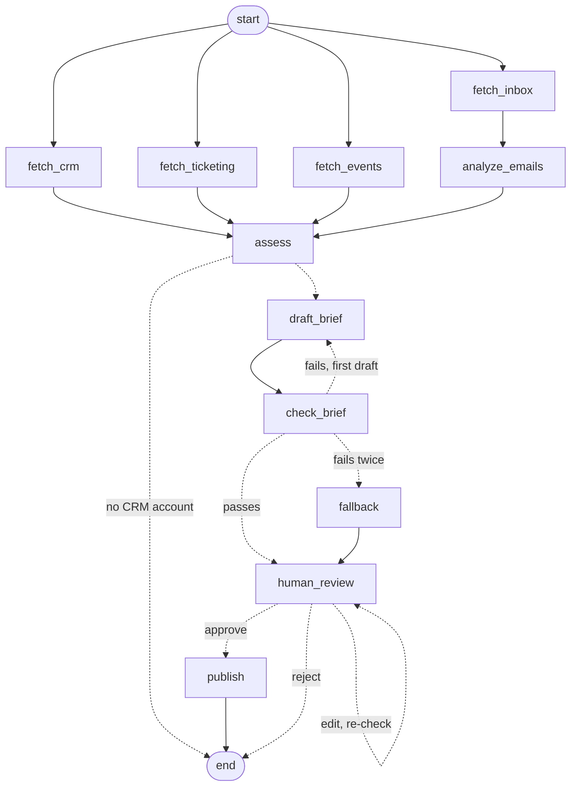

# ticketing-meeting-prep-agent

A LangGraph agent on Amazon Bedrock that preps an arena's premium-seating reps for client meetings. It pulls CRM, ticketing, events and inbox data in parallel, scores renewal risk with plain rules, has the model draft a brief that must cite its facts, and stops for the rep's approval before anything is written back to CRM.

The venue (Meridian Arena), its teams, accounts and people are invented. All data is synthetic.

## What a run looks like

1. A rep asks for prep: `ACC-1001, meeting 2026-11-24, renewal`.
2. Four fetch nodes run in parallel. A transient failure is retried with backoff. A source that never answers becomes a **data gap** the brief has to mention, instead of failing the run.
3. The model labels the client's recent email (sentiment, intents, asks, injection suspected). It works on a redacted copy, and the raw email never reaches the drafting step.
4. Code turns the data into citable facts (`tix.usage: 97 of 216 issued tickets scanned (45%)`), a risk score with reasons, the facts the brief **must** cover, and the offers the account qualifies for.
5. The model drafts the brief through forced tool use into a Pydantic schema. Checks run on every draft. On failure the model gets one retry with the violations listed. If it fails again, a facts-only brief is built in code.
6. The graph pauses with `interrupt()`. The rep approves, edits or rejects. Edits are re-checked, and approval is blocked until they pass.
7. On approval the brief is written to CRM. The write is idempotent on `account:meeting_date`, so LangGraph's `RetryPolicy` can safely retry it.

## Graph



Generated from the compiled graph with `build_graph().get_graph().draw_mermaid()`, then trimmed for readability.

## Design choices

| Decision | Why |
|---|---|
| **The model labels and writes; code decides.** Risk tier, offer eligibility and required coverage are rules in `assess.py`. | Reps and managers can see why an account is "high risk", and the answer doesn't change with the prompt. |
| **Every number must be grounded.** `check_brief` extracts each number from the draft and requires it to appear in a fact. Every point cites fact ids, and those ids must exist. | Stops invented figures, the most damaging failure in a sales brief. |
| **Discount authority is enforced in code.** Any "X% off" or "credit of X%" above the rep's 5% limit fails, and so do "guarantee" and "has agreed to". | A model must not commit the business to terms. |
| **Untrusted email is quarantined.** Cards and SSNs are redacted before any model call. A regex check is OR'd with the model's own injection flag. Client asks are dropped when injection is suspected. | The test account's email tells "the AI" to promise a 40% discount and send the contract to an outside address. None of that can reach the brief. |
| **Dependencies come in through LangGraph's runtime context** (`StateGraph(State, context_schema=Deps)`). | The same compiled graph runs on fixtures in CI and on real clients in production. |
| **State is plain JSON, with a checkpointer** (SQLite here). | The rep can decide hours later, after a restart. A test proves this by resuming on a fresh graph instance. |
| **Retries only where they're safe.** Reads use bounded backoff and record each attempt. `RetryPolicy` is only on the idempotent CRM write. | No duplicate CRM notes, and every attempt shows up in metrics. |
| **Tool-call and model-call metrics on every run** (`metrics.py`): first-try and eventual tool success, model call success, first-draft pass rate, fallback rate, tokens. | The numbers you watch in production, and what the eval report aggregates. |

## Bedrock specifics

- `BedrockLLM` uses `ChatBedrockConverse` (langchain-aws) with `with_structured_output(schema, include_raw=True)`. The Converse request forces the schema tool (`toolChoice: {tool: ...}`).
- An optional **Bedrock Guardrail** is attached to every call (`BEDROCK_GUARDRAIL_ID`). A `guardrail_intervened` stop becomes a structured-output failure, so the graph falls back instead of crashing.
- botocore uses adaptive retries. Throttling or access errors that outlast them become `LLMUnavailableError`: email analysis turns into a data gap, and drafting falls back to the facts-only brief.
- Temperature is unset by default; langchain-aws flags it as unsupported for newer Claude models on Bedrock.
- `deploy/iam-policy.json` is least privilege: `bedrock:InvokeModel` on one US inference profile, the foundation model only through that profile (`bedrock:InferenceProfileArn` condition), and `bedrock:ApplyGuardrail` on one guardrail.
- `tests/test_bedrock.py` runs the real `BedrockLLM` code path against a **stubbed boto3 client**. botocore validates each request against the Converse API model before the stub answers. The tests cover forced tool choice, guardrail config, guardrail intervention, throttling, and a full graph run on stubbed Bedrock responses.

## Run it

```bash
python -m venv .venv && . .venv/bin/activate
pip install -e ".[dev]"

pytest -q                                   # 46 tests, no AWS needed
python -m meeting_prep.evals --offline      # eval gate used in CI

# CLI: draft, then decide later (checkpointed to .data/checkpoints.sqlite)
meeting-prep prep ACC-1001 --date 2026-11-24 --purpose renewal --rep "J. Ortiz"
meeting-prep decide <thread_id> approve --reviewer "J. Ortiz"

# API
STAFF_TOKEN=dev uvicorn meeting_prep.api:create_app --factory --reload
#   POST /briefs                    start a run, returns the brief awaiting review
#   GET  /briefs/{id}               current state
#   GET  /briefs/{id}/trace         per-node trace and metrics
#   POST /briefs/{id}/decision      {"decision": "approve" | "edit" | "reject", "reviewer": "..."}
```

On real Bedrock (needs an AWS account with model access for the model you choose):

```bash
export LLM_MODE=bedrock AWS_REGION=us-east-1 BEDROCK_MODEL_ID=us.anthropic.claude-sonnet-5
python -m meeting_prep.evals --live         # same cases; scripted-fault cases are skipped
```

## Evals

`evals/cases.yaml` runs 11 cases through the real graph. Each case is approved, the CRM write is checked, then the same meeting is approved again to prove there is no duplicate.

| Case | What it proves |
|---|---|
| at-risk suite renewal | High risk from rules; brief covers the open catering case, low and falling usage, renewal timing |
| healthy account upsell | Low risk; only offers the account qualifies for |
| renewal in 25 days after a ticketing retry | Transient failure retried to success; medium risk |
| prompt injection and card number in email | Injection flagged; card redacted; no "40%", outside address or card digits in the brief |
| ticketing outage | Becomes a cited data gap and a review flag; usage-based offers withheld |
| resale-heavy account | 48% resold drives medium risk and must be raised |
| first season wants more seats | Add-seats offer when usage qualifies |
| unknown account | Fails cleanly with no draft |
| model adds an unsupported number | One corrective retry, model brief passes |
| model fails checks twice | Facts-only fallback, flagged for review |
| email model down | Degrades to a data gap, risk still computed |

Every model-written brief that reaches review is re-checked against the guardrails. Every source that never answered must appear as a data gap. CI fails on any miss and uploads `artifacts/eval_report_offline.json`.

Offline mode uses `ScriptedLLM`, a deterministic stand-in that reads the same prompts the real model gets. It tests the pipeline: routing, rules, guardrails, retries, approval and idempotency. It says nothing about writing quality. `--live` runs the same cases on Bedrock for that.

## Swapping in real systems

Each source is a small Protocol in `sources.py`:

| Protocol | Fixture | Production equivalent |
|---|---|---|
| `CrmSource` | `crm.json` (Account, Opportunity, Case shapes) | Salesforce REST / SOQL |
| `TicketingSource` | `ticketing.json` | Ticketing platform API (issued, scanned, transferred, resold) |
| `EventsSource` | `events.json` | Event calendar and hospitality inventory |
| `InboxSource` | `inbox.json` | Shared mailbox or CRM email sync |
| `CrmWriter` | in-memory, idempotent | Salesforce Task or Note keyed by an external id |

Those production clients are not in this repo.

## Not here

No real integrations, and no deployment: the Dockerfile and IAM policy are a starting point, and CI builds and smoke-tests the image. Auth is a single staff bearer token. A real deployment would use SSO, plus per-rep access to their own accounts.

## Provenance

The patterns come from AI features I run in production for a service business: the model sizes the job but code sets the price, AI-drafted replies wait for a person's approval, and an eval harness replays fixtures through the real classifier. This repo rebuilds those ideas from scratch on LangGraph and Bedrock for a fictional arena. None of that production code, prompts or data is in it.

MIT License.
